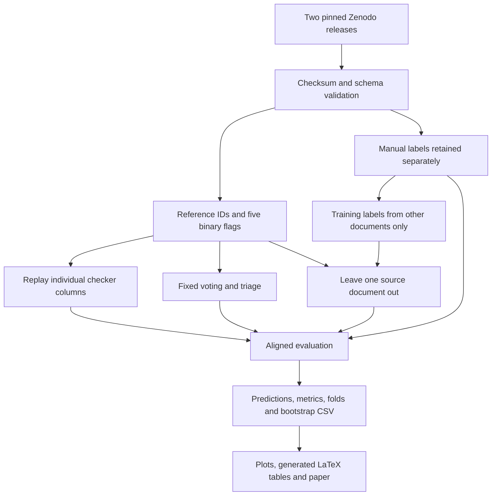

# Frozen blueprint and data flow

Authoritative configuration: `configs/protocol.json`. Freeze evidence: `provenance/protocol_freeze.json` and first Git commit. The file was frozen before reference-level data and ensemble outcomes were read; published aggregate results were already known. This is a local protocol freeze, not external preregistration. Later changes appear in `protocol_amendments.md`.

Controls: same input rows, label polarity, metric definitions, and seeds within a release. Prediction uses only five flags. Text is used only for a conservative duplicate screen. Fixed methods need no training split. Adaptive k selection uses the other source documents, mean document BA, and smallest-k tie-break. No random row-level training/test split is used.

Primary k=3; primary comparator RefChecker. Success: FPR reduction ≥0.10 absolute and recall ≥0.80. Threshold sensitivity k=1..5; five strict-3-of-4 removals; triage 0–1 accept / 2–3 defer / 4–5 flag. Conditional paired bootstrap: 5,000 samples within source, seed 20261018. Seven microtiming repetitions count existing flags only.

Pre-run checks actually implemented: checksum equality, frozen protocol equality, 104 rows, class counts, expected column names, legal labels/flags, unique compound IDs, nonempty reference text, duplicate exclusion, and held-out prediction coverage. The published RefChecker confusion check applies only to v1.0.0.

Original estimates: seconds of CPU processing and minutes for plots/installations; no model inference. Actual execution times are in each run manifest. Network downloads, typesetting, and final inspection took additional wall time and are not included in algorithm timing.
